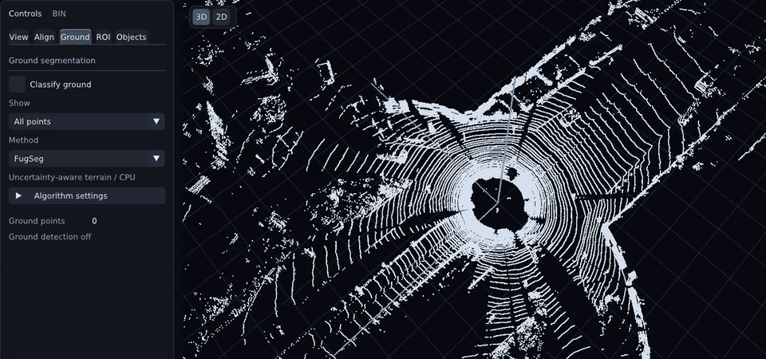
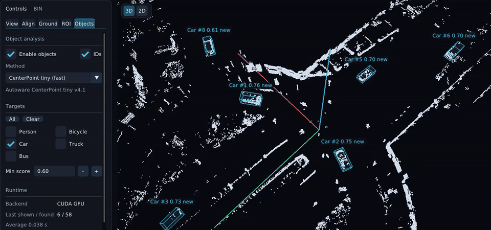
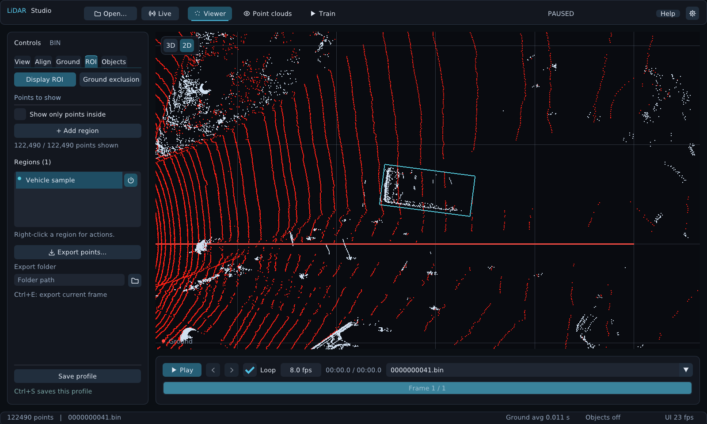

# LiDAR Studio

**Inspect point clouds. Separate ground. Prepare labeled datasets.**

A desktop workspace for LiDAR playback, ground segmentation, clustering, object detection and interactive ROI editing—from a raw scan to a dataset ready for annotation.

[Download](https://github.com/YooJuno/lidar_studio/releases) · [Latest builds](https://github.com/YooJuno/lidar_studio/actions/workflows/build-release.yml) · [Detailed guide (Korean)](docs/guide.md)

## Highlights

- **Point clouds, easy to explore.** Switch between 3D and rotatable 2D views, scrub recordings and step through frames. Browse BIN, NPY and PCD folders, review labels and keep the same camera position and zoom between samples.
- **Visual ground segmentation.** Choose **FugSeg, GSeg3D, Patchwork++, Fast grid, Grid or RANSAC**. Tune parameters and show all points, ground only or obstacles only. Align scans manually or use IMU leveling.
- **Clustering for obstacle analysis.** Group points with **Euclidean 3D** or **Projected XY** clustering, adjust distance and vertical separation, and inspect cluster boxes.
- **Learned object detection.** Use **AWML ShortRange** or **CenterPoint tiny** for people, bicycles, cars, trucks and buses. Filter classes and confidence, and follow persistent object IDs with Kalman tracking.
- **ROI labeling and dataset export.** Draw, move, resize and rotate 3D boxes. Name and color regions, attach class-name hints and export cropped points with frame, ROI and coordinate metadata.

Background loading and analysis keep the interface usable. Separate **Ground avg / Objects avg** indicators show recent processing times without rapidly changing labels.

## Demos

**Ground segmentation — FugSeg**

[](docs/media/ground-segmentation.mp4)

**Ground OFF → ON → OFF → ON**, with the camera fixed. OFF shows the complete cloud; ON removes the classified road points and keeps obstacles. [MP4](docs/media/ground-segmentation.mp4).

**Object detection — CenterPoint tiny**

[](docs/media/object-detection.mp4)

Cyan boxes show **vehicle predictions and track IDs** at a minimum score of **0.60**. **FugSeg removes ground from the view**, keeping the vehicles and boxes easy to see. Cluster overlays are off. [MP4](docs/media/object-detection.mp4).

Both previews use the same **90 consecutive KITTI Raw scans**, shown at the source rate of **10 Hz**. They are frame-by-frame application captures, not runtime benchmarks. [Source and recording details](docs/media/SOURCE.md).

## Get started

Get a package from [Releases](https://github.com/YooJuno/lidar_studio/releases) or an artifact from [Actions](https://github.com/YooJuno/lidar_studio/actions/workflows/build-release.yml).

| Platform | Launch | Inputs |
| --- | --- | --- |
| Ubuntu 24.04 | Install the `.deb`, then run `lidar_studio` | BIN, NPY, PCD; ROS 2 bags and live topics with Jazzy |
| Windows | Extract the ZIP; run `lidar_studio.exe` | BIN, NPY, PCD |
| macOS | Open `lidar_studio.app` | BIN, NPY, PCD |

Ubuntu installation: `sudo apt install ./lidar_studio-*.deb` (**ROS 2 Jazzy** required). Windows/macOS packages and ROS-disabled source builds work without ROS.

<details>
<summary>Build from source on Ubuntu</summary>

```bash
sudo apt install cmake g++ libglfw3-dev libglew-dev libpcl-dev libnanoflann-dev libcurl4-openssl-dev libssl-dev zenity
git clone --recursive https://github.com/YooJuno/lidar_studio.git
cd lidar_studio
# For ROS 2 bag/live support, source Jazzy before configuring:
# source /opt/ros/jazzy/setup.bash
cmake -S . -B build -DCMAKE_BUILD_TYPE=Release
cmake --build build --parallel 2
./build/lidar_studio
```

The core viewer and ground algorithms work without Python or a GPU. Detection and training use optional Python environments.

</details>

## Try a driving recording

Choose **Open… → Driving examples…**, select a recording length, then **Download and open**:

| Sensor | Channels / view | 30 s · 300 frames | 1 min · 600 frames |
| --- | --- | --- | --- |
| **Velodyne HDL-32E** | 32 · 360° | 434 MB | 860 MB |
| **Hesai XT32** | 32 · 360° | 922 MB | 1.84 GB |
| **Hesai AT128P** | 128 · forward 120° | 2.30 GB | 4.61 GB |

A six-scan **Quick preview** (12 MB) is also available. The default is the smaller Velodyne 30-second recording.

**No login, Python, ROS or GPU is needed.** Real consecutive scans open with ground segmentation and 10 Hz playback. Downloads show progress and ETA, support cancellation/retry and reuse verified scans across lengths. Each sensor has a separate profile and initial mount correction. Manage saved recordings and **Delete download** in the same chooser.

[UrbanV2X](https://huggingface.co/datasets/polyutaslab/UrbanV2X) is published by TAS Lab, Hong Kong Polytechnic University, under **CC BY-NC-SA 4.0**. The quick preview comes from [Patchwork++](https://github.com/url-kaist/patchwork-plusplus/tree/3e6903a1d5537a4cc2ace897b0bbb98a92d6014c/data). [Example details, full recordings and KITTI instructions](docs/examples.md).

## Find your workflow

| Workspace | What to do |
| --- | --- |
| **Open… / Viewer** | Open or drop a recording. Add a recordings folder to the source list, then play, pause or seek. |
| **Align / Ground** | Set sensor height and orientation, choose a ground method and inspect its classification. |
| **Objects** | Select learned detection or geometric clustering; adjust targets, confidence or cluster settings. |
| **ROI** | Draw in 2D and edit directly on the canvas. Right-click a region for details, rename, duplicate or delete. |
| **Point clouds** | Open a file or dataset folder, step through samples and inspect point labels or annotated boxes. Delete unwanted samples with undo support. |
| **Train** | Connect labeled data to LitePT or CenterPoint/MMDetection3D training projects; configure parameters, check setup and monitor jobs. |

**Space** play/pause · **←/→** previous/next · **Ctrl+O** open · **R** draw ROI · **Ctrl+E** export current ROI frame · **Ctrl+S** save profile

## ROI labeling and export



Two independent tools serve different purposes:

- **Display ROI:** view or export points inside enabled boxes. Multiple boxes form a union.
- **Ground exclusion:** keep points visible but skip them during ground segmentation. Edit the boxes, then **Apply**.

Use **ROI → Display ROI → Export points…** to select frames, sampling interval, class name, coordinates and destination. Set an **Export folder** once, then press **Ctrl+E** to collect samples while browsing.

Exports contain **NPY** (`float32`, `N × 4`: `x, y, z, intensity`), matching **PCD** files and **JSON** metadata. Choose original sensor or aligned coordinates. ROI/class names are saved as **draft annotation metadata**; pointwise ground truth and object-box labels are separate annotations for review and training. [Label formats and training setup](docs/guide.md#데이터셋-열람과-학습).

## Optional detection and live sensors

From a source checkout, install pretrained models once, then enable a model in **Objects**:

```bash
python3 tools/setup_detector.py          # CPU
# python3 tools/setup_detector.py --cuda # NVIDIA GPU
```

Class and score changes filter cached predictions without repeating inference. Detection quality depends on the sensor and scene; geometric clusters have no semantic class. [Model setup](docs/guide.md#사람차량-인식--원본-tier-iv-모델).

**Live → Connect** subscribes to ROS 2 LiDAR and IMU topics. Freeze the displayed scan, resume the latest data or record the original stream to a bag. Subscription and recording continue while the display is frozen. Sensor drivers run separately. [Sensor setup and recording](docs/guide.md#실시간-lidar--imu).

## Development

C++17 · OpenGL · GLFW · Dear ImGui · PCL · libcurl · OpenSSL. Ground methods integrate pinned [FugSeg](https://github.com/Leo-YuLi/FugSeg), [GSeg3D](https://github.com/dfki-ric/ground_segmentation) and [Patchwork++](https://github.com/url-kaist/patchwork-plusplus) implementations.

Run checks with `ctest --test-dir build --output-on-failure`. GitHub Actions builds Ubuntu, Windows and macOS packages. Passing builds for `v*` tags publish release assets. The [guide](docs/guide.md) contains advanced settings and validation details. [KITTI credit and screenshot license](docs/images/README.md).
