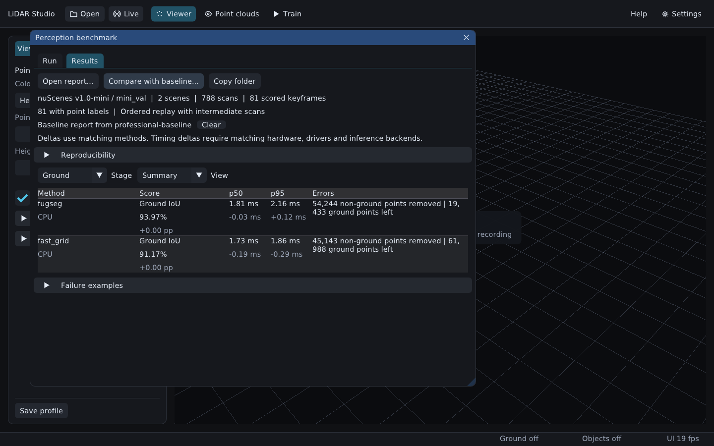
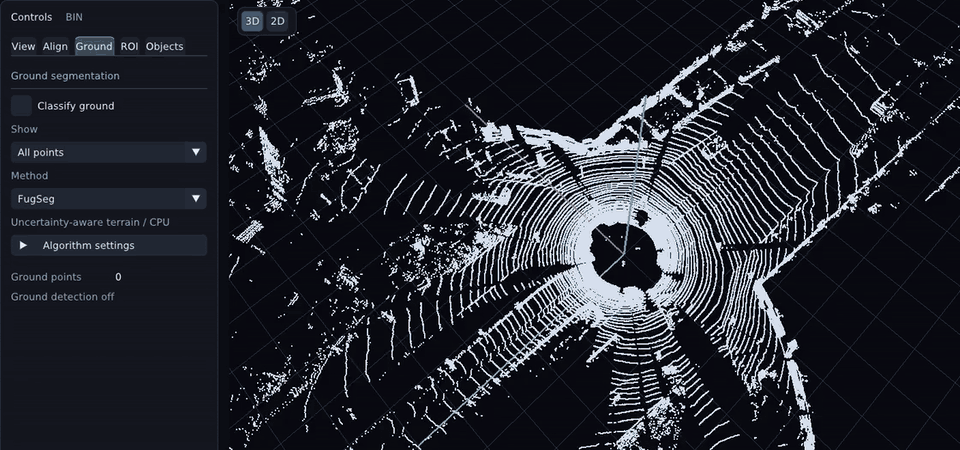
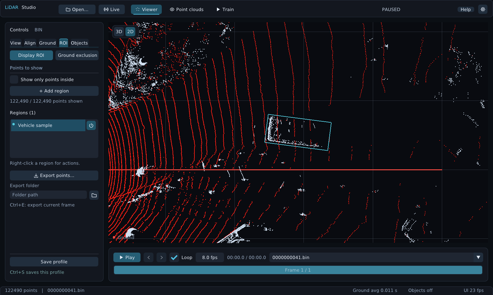

# LiDAR Studio

**Open real LiDAR recordings. Try multiple algorithms. Compare accuracy and speed.**

LiDAR Studio is a desktop workspace for testing LiDAR perception. Download public recordings in the app or open your own data, switch algorithms on the same scan, and measure their performance against labeled nuScenes data.

[Download latest](https://github.com/YooJuno/lidar_studio/releases/latest) · [Example datasets](#example-datasets) · [Perception benchmark](#perception-benchmark) · [Detailed guide (Korean)](docs/guide.md)

## Example datasets

**Open → Public examples** downloads and opens real sensor recordings without an account, Python, ROS or a GPU. The same opener takes local BIN, NPY, PCD and LiDAR PCAP files or recording folders. The Jazzy build also opens ROS 2 bags.

| Dataset | Sensors | Recording |
| --- | --- | --- |
| UrbanV2X | Velodyne HDL-32E, Hesai XT32 and AT128P | 30 or 60 seconds of outdoor driving |
| Ouster SDK | OS0-128, OS1-128 and OS2-128 | 20–26 seconds of urban driving, with calibration |
| Patchwork++ | Velodyne | Six-scan preview, 12 MB |

Downloads show progress. Cached recordings reopen offline and can be deleted in the app. [Example sources, licenses and KITTI instructions](docs/examples.md).

## Perception benchmark

Replay the same scans through selected ground methods, learned detectors and tracking profiles. Import the extracted **nuScenes** dataset for quantitative scores. For pointwise ground evaluation, include the **LiDARSeg** labels. [Benchmark guide and dataset downloads](docs/benchmark.md).

| Stage | What you can compare |
| --- | --- |
| Ground segmentation | IoU, precision, recall and how many non-ground points each method misclassifies |
| Object detection | Local AP, false positives and missed detections by class |
| Tracking | Local IDF1, ID switches and track interruptions across tracker settings |

Check per-stage latency, inspect scene and class breakdowns, and identify failure frames. Load a previous report to see score and latency changes on matched inputs. Reports include per-frame results and TSV exports.



*Example run on nuScenes Mini validation, with 81 labeled keyframes across two scenes. The screenshot shows the accuracy, processing time and error counts for each ground method.*

## Highlights

- **Point clouds, easy to explore.** Switch between 3D, rotatable 2D and a **360° sensor panorama** with distance colors. Browse BIN, NPY, PCD and LiDAR PCAP recordings and review labels.
- **Direct Ethernet recording.** Connect a supported Hesai, Velodyne, Livox, Ouster or RoboSense LiDAR and view or record its UDP stream with no ROS setup.
- **Visual ground segmentation.** Choose **FugSeg, GSeg3D, Patchwork++, Patchwork, LineFit, Fast grid, Grid, RANSAC or TerraSeg Small**. Tune parameters and show all points, ground only or obstacles only. Align scans manually or use IMU leveling.
- **Clustering for obstacle analysis.** Group points with **Euclidean 3D** or **Projected XY** clustering, adjust distance and vertical separation, and inspect cluster boxes.
- **Learned object detection.** Use **AWML ShortRange**, **CenterPoint tiny**, **CenterPoint base** or **TransFusion LiDAR** for people, bicycles, cars, trucks and buses. Filter classes and confidence, and follow persistent object IDs with Kalman tracking.
- **ROI labeling and dataset export.** Draw, move, resize and rotate 3D boxes. Name and color regions, attach class-name hints and export cropped points with frame, ROI and coordinate metadata.

Background loading and analysis keep the interface usable. Separate **Ground avg / Objects avg** indicators show recent processing times without rapidly changing labels.

Choose **Settings (gear) → Appearance → Light / Dark** to switch the entire
interface and point-cloud canvas. Light mode uses a white canvas and contrasting
point-label colors for inspection and figures. The choice is saved automatically
and shared by Viewer, Point clouds and Train.

## Demos

**Ground segmentation — FugSeg**

[](docs/media/ground-segmentation.mp4)

**Ground OFF → ON → OFF → ON**, with the camera fixed. OFF shows the complete cloud; ON removes the classified road points and keeps obstacles. [MP4](docs/media/ground-segmentation.mp4).

**Object detection & tracking — AWML ShortRange**

[](docs/media/object-detection.mp4)

Follow the yellow **Bicycle #4** and the cyan car tracks as their boxes and trails move through consecutive scans. FugSeg hides the ground. `weak` marks a lower-score observation that still supports an existing ID, and `est.` marks a predicted box. [MP4](docs/media/object-detection.mp4).

Both demos play consecutive KITTI Raw scans at **10 Hz**. [Source and recording details](docs/media/SOURCE.md).

## Get started

Get the newest verified package from [Latest release](https://github.com/YooJuno/lidar_studio/releases/latest) or an artifact from [Actions](https://github.com/YooJuno/lidar_studio/actions/workflows/build-release.yml).

| Platform | Download | Launch |
| --- | --- | --- |
| Ubuntu 22.04 x86-64 | `Ubuntu22.04-x86_64-standalone.deb` | Install with APT, then open LiDAR Studio from the app menu |
| Ubuntu 24.04 x86-64 | `Ubuntu24.04-x86_64-standalone.deb` | Install with APT, then open LiDAR Studio from the app menu |
| Ubuntu 24.04 with ROS 2 Jazzy | `Ubuntu24.04-x86_64-jazzy.deb` | Install with APT after configuring the Jazzy repository |
| Windows x64 | `Windows-AMD64.zip` | Extract the ZIP and run `lidar_studio.exe` |
| macOS 15+ (Apple Silicon) | `Darwin-arm64.dmg` | Open the DMG and copy `LiDAR Studio.app` to Applications |

On Ubuntu, download the `.deb` for your Ubuntu version. APT installs its dependencies in the same step. Run this command from the download folder on Ubuntu 22.04.

```bash
sudo apt install ./lidar_studio-*-Ubuntu22.04-x86_64-standalone.deb
```

The standalone packages support direct Ethernet, PCAP and point-cloud files. The Jazzy package also opens ROS 2 bags and topics. The older `Linux-x86_64` files in v0.2.88 were built for Ubuntu 24.04.

The macOS download is **ad-hoc signed, not Apple-notarized**; macOS may block its first launch. See [macOS launch troubleshooting](docs/guide.md#macos-first-launch) for signature verification and a per-app exception. Intel Macs are not supported by the ARM64 download.

<details>
<summary>Build from source on Ubuntu</summary>

```bash
sudo apt install cmake g++ libglfw3-dev libglew-dev libpcl-dev libnanoflann-dev libcurl4-openssl-dev libssl-dev libarchive-dev zenity
git clone --recursive https://github.com/YooJuno/lidar_studio.git
cd lidar_studio
cmake -S . -B build -DCMAKE_BUILD_TYPE=Release -DLIDAR_VIEWER_ENABLE_CUDA=OFF -DLIDAR_VIEWER_ENABLE_ROSBAG=OFF
cmake --build build --parallel 2
./build/lidar_studio
```

The core viewer and ground algorithms work without Python or a GPU. Detection and training use optional Python environments.

[Code structure and external dependencies](docs/code-structure.md)

</details>

## Find your workflow

| Workspace | What to do |
| --- | --- |
| **Open / Viewer** | Open or drop a recording. Add a recordings folder to the source list, then play, pause or seek. |
| **Align / Ground** | Adjust the scan's orientation and vertical offset, set the expected ground Z, and inspect the selected method's classification. |
| **Objects** | Select learned detection or geometric clustering; adjust targets, confidence or cluster settings. |
| **ROI** | Draw in 2D and edit directly on the canvas. Right-click a region for details, rename, duplicate or delete. |
| **Point clouds** | Open a file or dataset folder, step through samples and inspect point labels or annotated boxes. Delete unwanted samples with undo support. |
| **Train** | Connect labeled data to LitePT or CenterPoint/MMDetection3D training projects; configure parameters, check setup and monitor jobs. |

**Space** play/pause · **←/→** previous/next · **Ctrl+O** open · **R** draw ROI · **Ctrl+E** export current ROI frame · **Ctrl+S** save profile

## ROI labeling and export



Two independent tools serve different purposes:

- **Display ROI:** view or export points inside enabled boxes. Multiple boxes form a union.
- **Ground exclusion:** keep points visible but skip them during ground segmentation. Edit the boxes, then **Apply**.

Use **ROI → Display ROI → Export points…** to select frames, sampling interval, class name, coordinates and destination. Set an **Export folder** once, then press **Ctrl+E** to collect samples while browsing.

Exports contain **NPY** (`float32`, `N × 4`: `x, y, z, intensity`), matching **PCD** files and **JSON** metadata. Choose original sensor or aligned coordinates. ROI/class names are saved as **draft annotation metadata**; pointwise ground truth and object-box labels are separate annotations for review and training. [Label formats and training setup](docs/guide.md#데이터셋-열람과-학습).

## Live sensors

Put the computer on the sensor's Ethernet subnet and set the sensor to send UDP data to the computer. In **Live**, choose **Auto** or select the model, then **Connect**. The viewer shows the UDP route while waiting. Use **Record** to save raw point and available auxiliary packets to `lidar.pcap`. **Freeze** holds the displayed scan while recording continues. After **Stop recording**, use **Open PCAP** below the viewer to replay the capture.

Supported models include **Hesai XT32, XT16, XT32M2X, AT128 / AT128P; Velodyne VLP‑16, Puck Hi‑Res, HDL‑32E, VLP‑32C; Livox Mid‑360; Ouster OS0 / OS1 / OS2; and RoboSense M1 / M2 / M3**. The guide lists ports, per-sensor calibration files and the optional ROS 2 source. [Sensor setup and recording](docs/guide.md#실시간-lidar--imu).

## Optional detection

**Mac downloads include the original tiny and AWML ShortRange models with a private CPU runtime.** Open a cloud, then enable a model in **Objects**; Homebrew and a separate Python installation are not required. The first model load can take a few seconds. An explicit user detector configuration takes priority over the built-in runtime.

If the models are missing, choose **Objects → Install CPU models**. Preparation runs in the background with download progress, cancellation and retry. Both models load automatically after validation. Apple Silicon source builds also prepare their own Python runtime; no terminal or separate Python installation is needed. Linux/Windows setup uses an installed Python 3.10–3.13.

For the optional original Autoware Base weights, select **CenterPoint base** and choose **Install CenterPoint base**. The installer can reuse an existing model runtime.

Select **Objects → TransFusion LiDAR → Install TransFusion LiDAR** for the optional Autoware ONNX model. It takes XYZ and raw 8-bit-scale reflectivity from the source. Its installer downloads about 165 MB of weights. [Autoware model card](https://huggingface.co/AutowareFoundation/lidar_transfusion).

The optional command-line installer remains available for custom CUDA environments:

```bash
python3 tools/setup_detector.py          # CPU
# python3 tools/setup_detector.py --cuda # NVIDIA GPU
# python3 tools/setup_detector.py --model base # Optional Autoware Base weights
# python3 tools/setup_detector.py --model transfusion # Optional Autoware TransFusion LiDAR weights
```

Class and score changes filter cached predictions without repeating inference. Detection quality depends on the sensor and scene; geometric clusters have no semantic class. [Model setup](docs/guide.md#사람차량-인식--원본-tier-iv-모델).

### Optional learned ground segmentation

**Ground → TerraSeg Small** uses the official noncommercial weights. The optional runtime requires Linux x86-64, NVIDIA Ampere/Ada/Hopper with CUDA, `git` and `uv`. Choose **Copy setup command** in the app, run it in a terminal and then choose **Retry TerraSeg**. The first setup downloads several GB for the CUDA runtime. [TerraSeg model and license](https://huggingface.co/TedLentsch/TerraSeg).

## License and contact

Original LiDAR Studio code is licensed under [MIT](LICENSE), copyright 2026 Yoo Junho.
Files with their own license headers and third-party components keep those terms;
see [third-party notices](THIRD_PARTY_NOTICES.md). Pretrained models retain their
original licenses. KITTI-derived demo media and UrbanV2X examples have separate
noncommercial data licenses; they are not covered by the application's MIT license.

Developer: **Yoo Junho** · [juno980220@naver.com](mailto:juno980220@naver.com) · [Issues](https://github.com/YooJuno/lidar_studio/issues).

## Development

C++17 · OpenGL · GLFW · Dear ImGui · PCL · libcurl · OpenSSL. Ground methods integrate pinned [FugSeg](https://github.com/Leo-YuLi/FugSeg), [GSeg3D](https://github.com/dfki-ric/ground_segmentation), [Patchwork++](https://github.com/url-kaist/patchwork-plusplus) and [LineFit](https://github.com/lorenwel/linefit_ground_segmentation) implementations.

Run checks with `ctest --test-dir build --output-on-failure`. GitHub Actions builds Ubuntu, Windows and macOS packages. Every successful **main** build automatically publishes a versioned Release after **all three platforms** pass. Versions use the CMake major/minor series and the workflow run number; explicit `vMAJOR.MINOR.PATCH` tags retain their version. Packages and checksums are uploaded before the release becomes public. The [guide](docs/guide.md) contains advanced settings and validation details. [KITTI credit and screenshot license](docs/images/README.md).
