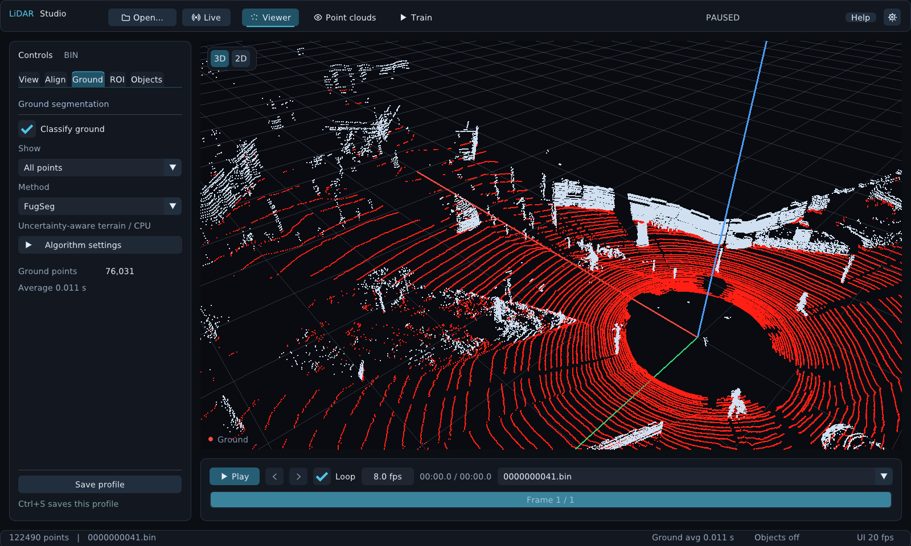
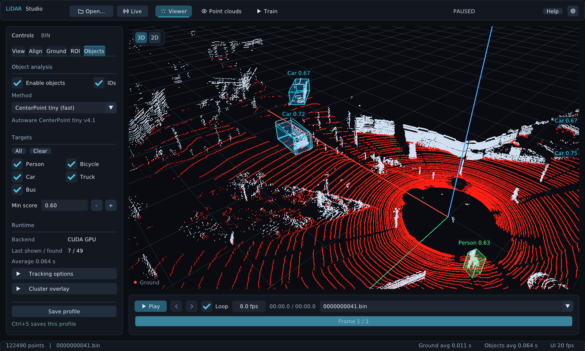

# Driving examples

## One-click public sample — no account required

In the app, select **Open… → Try driving example**. LiDAR Studio downloads six [public Patchwork++ example scans](https://github.com/url-kaist/patchwork-plusplus/tree/3e6903a1d5537a4cc2ace897b0bbb98a92d6014c/data), verifies them and starts playback with FugSeg ground segmentation. No browser login, Python environment, ROS installation or GPU is needed.

Downloads have progress, **Cancel / Esc** and **Retry** controls. Completed scans survive cancellation; invalid or incomplete files are never opened. Subsequent clicks reuse verified cached files, including when offline. Existing recordings and their profiles are preserved.

The default cache is `~/.local/share/lidar_viewer/examples/driving-v1` on Linux, `%LOCALAPPDATA%\LiDARViewer\examples\driving-v1` on Windows, or `~/Library/Application Support/LiDARViewer/examples/driving-v1` on macOS. An absolute `XDG_DATA_HOME` overrides the data location. The **example** profile can be saved independently.

These are a small demonstration set, distinct from the full KITTI Raw sequence below. [Demo recording and source credits](media/SOURCE.md).

## Full KITTI Raw sequence

The examples use **KITTI Raw**, sequence **2011_09_26_drive_0005_sync**. Its Velodyne scans are outdoor driving point clouds stored as binary XYZI arrays, so LiDAR Studio can open them directly without converting them to ROS bags.

### 1. Download the sequence

1. Open the [official KITTI Raw page](https://www.cvlibs.net/datasets/kitti/raw_data.php) and sign in or register. KITTI currently requires a login for dataset downloads.
2. Find **2011_09_26_drive_0005** and download **synced+rectified data**. The archive is named `2011_09_26_drive_0005_sync.zip`.
3. Extract the archive. Only `velodyne_points/data/*.bin` is needed for this example; camera images and separate calibration files are not required for point cloud viewing.

KITTI is provided by Andreas Geiger, Philip Lenz, Christoph Stiller and Raquel Urtasun. The dataset is licensed under [CC BY-NC-SA 3.0](https://creativecommons.org/licenses/by-nc-sa/3.0/); see the [official copyright and citation](https://www.cvlibs.net/datasets/kitti/).

#### Linux / macOS

From the repository root, with the ZIP in your Downloads folder:

```bash
mkdir -p dataset
unzip "$HOME/Downloads/2011_09_26_drive_0005_sync.zip" \
  '2011_09_26/2011_09_26_drive_0005_sync/velodyne_points/*' -d dataset

./build/lidar_studio \
  dataset/2011_09_26/2011_09_26_drive_0005_sync/velodyne_points/data --play
```

On Ubuntu, install `unzip` if needed. With an installed Ubuntu package, replace `./build/lidar_studio` with `lidar_studio`. For a macOS app bundle, use `./lidar_studio.app/Contents/MacOS/lidar_studio` from the folder containing the app.

#### Windows PowerShell

From the folder containing the extracted `lidar_studio.exe`:

```powershell
Expand-Archive -LiteralPath "$HOME\Downloads\2011_09_26_drive_0005_sync.zip" -DestinationPath .\dataset

.\lidar_studio.exe `
  .\dataset\2011_09_26\2011_09_26_drive_0005_sync\velodyne_points\data --play
```

You can also launch the app and use **Open… → Open file…** to select a single `.bin` scan. Opening the `data` folder on the command line loads the scan sequence for playback. **Point clouds** is the workspace for browsing exported samples and labels.

### 2. Explore the recording

- Use **Space** to pause/resume and **←/→** to move between scans. KITTI Raw records at **10 Hz**; set the playback rate to `10.0 fps` for that scan rate.
- Switch between **3D** and **2D**. Rotate or zoom the view to inspect parked vehicles, roadside structures and the road surface.
- Open **Ground**, enable **Classify ground** and select **FugSeg**, **GSeg3D** or **Patchwork++**. Compare **Ground only** and **Obstacles only** on the same paused frame.
- Open **Objects** and select **Euclidean 3D (clusters)** to inspect geometric obstacle groups. These groups do not assign vehicle/person classes.

### 3. Reproduce the screenshots

The KITTI screenshots use the zero-based scan index **41**, file `0000000041.bin` from this sequence:

```bash
./build/lidar_studio \
  dataset/2011_09_26/2011_09_26_drive_0005_sync/velodyne_points/data/0000000041.bin
```



For the ground view, enable **FugSeg**, select **All points** and choose **Uniform** coloring in **View**. Classified ground is red. Camera position and grid settings can be adjusted independently.

For the ROI view, choose **ROI → Display ROI**, draw a region around a vehicle in 2D and name it. Use **Export points…** to choose the coordinate system, class-name hint and output folder; use **Ctrl+E** for subsequent single-frame exports. Open the output folder in **Point clouds** to inspect the cropped samples.

### 4. Try learned detection

From a source checkout, install the optional models, then open the same scan with detection enabled:

```bash
python3 tools/setup_detector.py
./build/lidar_studio \
  dataset/2011_09_26/2011_09_26_drive_0005_sync/velodyne_points/data/0000000041.bin --detect
```

In **Objects**, choose **CenterPoint tiny (fast)** and `Min score = 0.60` for the model settings used below. AWML ShortRange is also available. The CPU runtime works without a GPU; `python3 tools/setup_detector.py --cuda` installs the optional NVIDIA runtime.



These are model predictions and manually placed ROI regions, not KITTI ground-truth annotations or an accuracy benchmark. KITTI OXTS IMU text files and tracklet XML are not automatically imported by this BIN example. For supported annotation formats, see the [detailed guide](guide.md#데이터셋-열람과-학습).

[Dataset credit and screenshot license](images/README.md).
